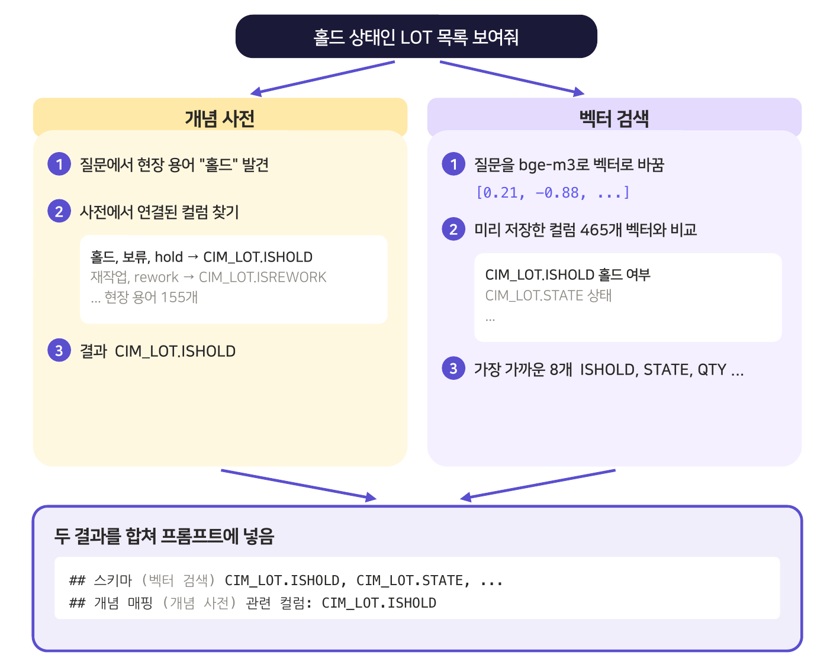
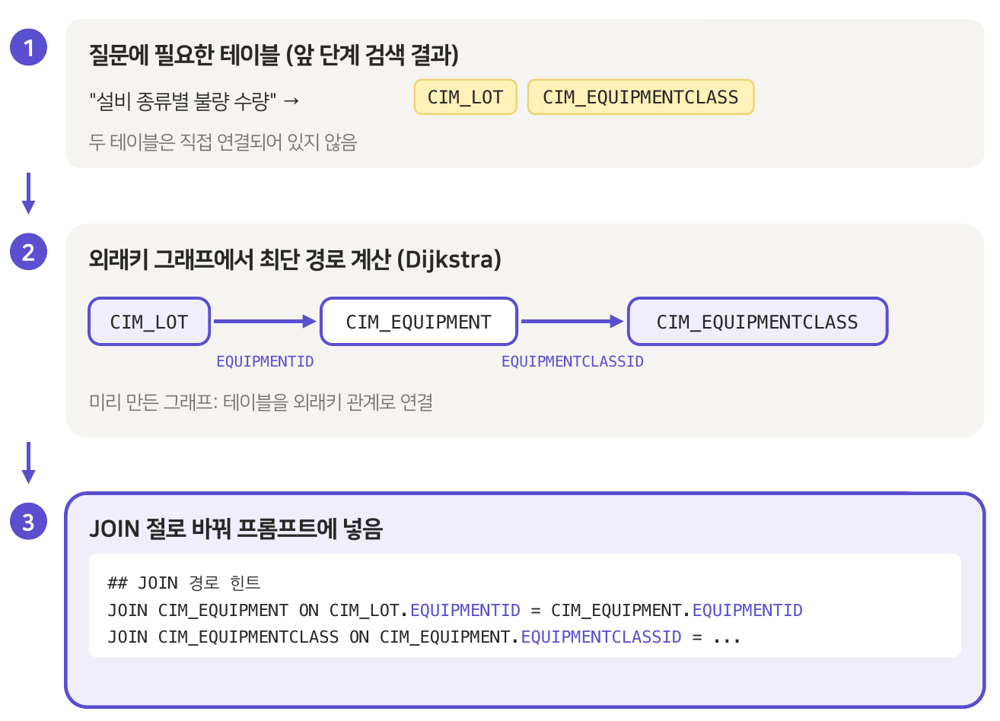
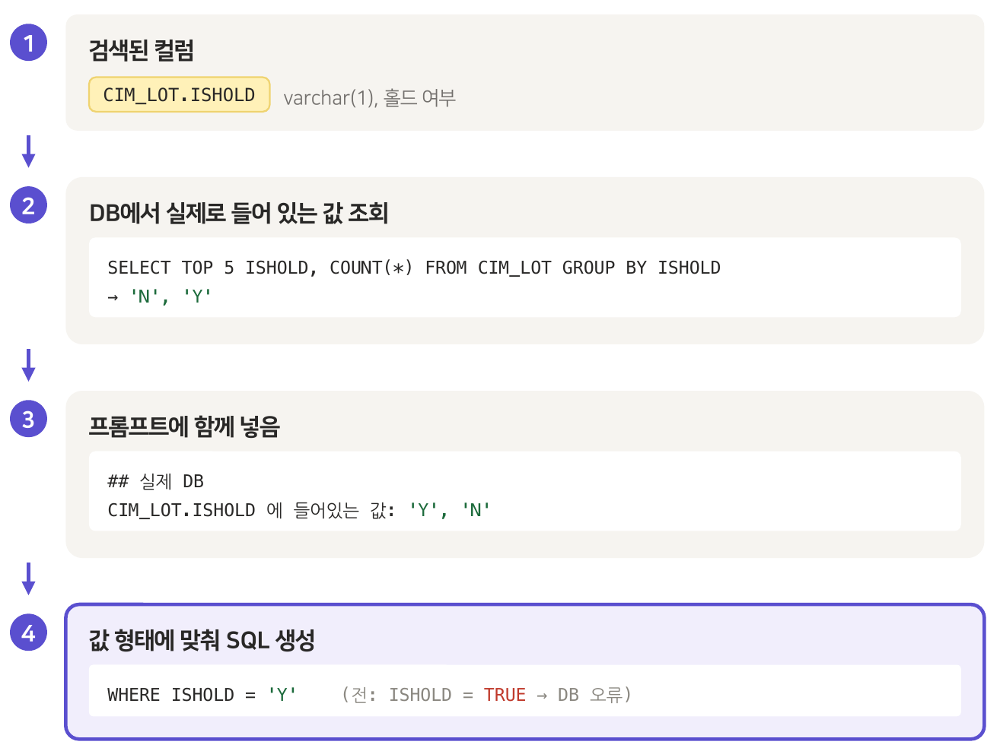

# Ask MES!

자연어 질문을 SQL문으로 바꿔 MES(제조 실행 시스템) 데이터를 조회하는 NL2SQL 시스템

**데모: https://ask-mes.web.app** (실제 공장 데이터 대신 가상 데이터로 동작합니다)

| 기간 | 구분 |
|------|------|
| 2026.03 ~ 2026.06 | 캡스톤디자인 팀 프로젝트, LS티라유텍 협업 |

<br>

## 🎯 개요

SQL을 모르는 제조 현업이 **자연어로 질문하면 SQL로 바꿔 MES DB를 조회**하는 시스템을 개발했습니다.
절삭공구 공장 MES (26테이블, 465컬럼, 2.7억 행), 외부 API를 쓸 수 없는 온프레미스 환경이라 오픈 모델 Qwen3.5-9B를 사용했습니다.

#### 질문하면 SQL을 만들어 실행하고 표로 보여 줌


#### 날짜, 숫자 결과는 차트로 전환


**맡은 역할 (AI, BE, FE)**: 개념 사전 구축, 하이브리드 검색, JOIN 경로 계산, 실제 DB 값 확인, 웹 개발과 공개 데모 배포

<br>

## 📂 시스템 구조

질문이 들어오면 필요한 DB 정보를 찾아 LLM에 함께 넘기고, LLM이 만든 SQL을 검사한 뒤 조회만 가능한 계정으로 실행합니다.


<br>

## 🔧 트러블 슈팅

### 1. 질문에 맞는 테이블 찾기

<table>
<tr>
<td width="48%"></td>
<td>
<b>문제</b><br>현장에서는 '홀드', '보류'라고 말하지만 DB에는 <code>CIM_LOT.ISHOLD</code>로 되어 있어 테이블을 못 찾았고, 465개 컬럼을 전부 넣기엔 컨텍스트가 부족했습니다.<br><br>
<b>해결</b><br>현장 용어 155개를 DB 컬럼에 연결한 개념 사전과 ChromaDB 벡터 검색을 합쳐, 질문에 필요한 스키마만 골라 LLM에 넘겼습니다.<br><br>
<b>결과</b><br>정답 테이블 적중률 개념 사전만 88%, 벡터 검색만 96%, 둘 다 쓰면 <b>100%</b><br><br>
<b>코드</b><br><code>backend/app/retrieval/retriever.py</code><br><code>backend/app/retrieval/ontology_loader.py</code><br><code>backend/data/mes_ontology.ttl</code>
</td>
</tr>
</table>

### 2. 테이블 사이 연결 경로 찾기

<table>
<tr>
<td width="48%"></td>
<td>
<b>문제</b><br>'설비 종류별 불량 수량'처럼 필요한 테이블이 직접 연결되어 있지 않으면 LLM이 중간 테이블을 찾지 못해 SQL 생성에 실패했습니다.<br><br>
<b>해결</b><br>외래키 관계를 그래프로 만들고 Dijkstra로 최단 경로를 계산해, 중간 테이블까지 포함한 JOIN 절을 힌트로 넣었습니다.<br><br>
<b>결과</b><br>SQL 실행 성공률 80.0% → <b>89.5%</b><br><br>
<b>코드</b><br><code>backend/app/retrieval/fk_resolver.py</code>
</td>
</tr>
</table>

### 3. 컬럼 안의 실제 값 맞추기

<table>
<tr>
<td width="48%"></td>
<td>
<b>문제</b><br><code>ISHOLD</code>에는 'Y', 'N'이 문자로 들어 있는데, LLM이 컬럼명만 보고 <code>ISHOLD = TRUE</code>로 비교해 실행 오류가 났습니다.<br><br>
<b>해결</b><br>SQL을 만들기 전에 대상 컬럼의 샘플과 값 분포를 DB에서 조회해 프롬프트에 함께 넣었습니다.<br><br>
<b>결과</b><br><code>ISHOLD = TRUE</code> (실행 오류) → <code>ISHOLD = 'Y'</code> (<b>실행 성공</b>)<br><br>
<b>코드</b><br><code>backend/app/sampling/live_sample.py</code>
</td>
</tr>
</table>

<br>

## 📊 결과

실제 MES DB로 직접 만든 GOLD 질문 200개(쉬움 80, 보통 78, 어려움 42)로 측정했습니다.


<br>

## 🛠 사용 기술


<br>

## 📁 폴더 구조

```
backend/
├── app/
│   ├── main.py                FastAPI 진입점
│   ├── pipeline.py            단계를 순서대로 호출
│   ├── config.py              설정값 (.env)
│   ├── routers/               웹 API (chat: 질문, data: 데이터 둘러보기)
│   ├── retrieval/             필요한 정보 찾기: retriever, ontology_loader(개념 사전), fk_resolver(JOIN 경로)
│   ├── sampling/              실제 값 확인: live_sample
│   ├── generation/            SQL 생성: prompts, llm, date_policy
│   ├── autofix/               자동 교정: sql_autofix
│   ├── validation/            검증: sql_validator, query_safety, code_values, concept_alignment
│   └── execution/             실행: sql_executor, sqlite_db, demo_db
├── data/                      스키마, 온톨로지, 코드값, 벤치마크 질문 세트, 데모용 SQLite DB
└── eval/                      벤치마크 실행, 채점, 논문 원본 결과

demo-db/                       데모 DB (가상 데이터) 테이블 정의, 생성 스크립트
web/                           웹 화면 (Next.js, React, TypeScript)
img/                           README 그림
hosting/                       ask-mes.web.app 연결 설정 (Firebase Hosting)
docker-compose.yml             데모 DB (SQL Server)
```
