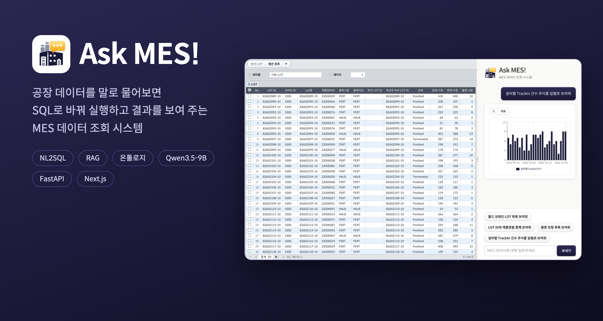
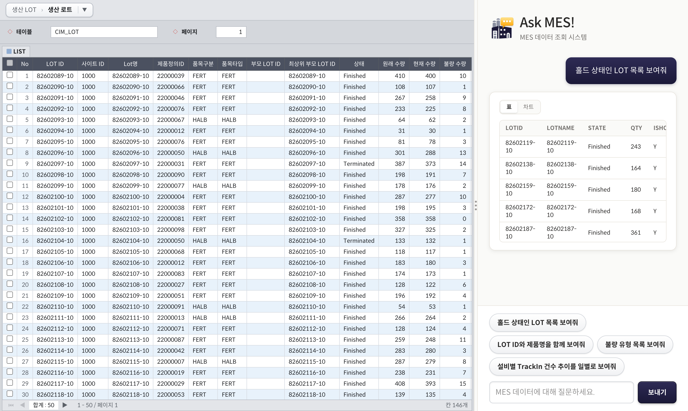
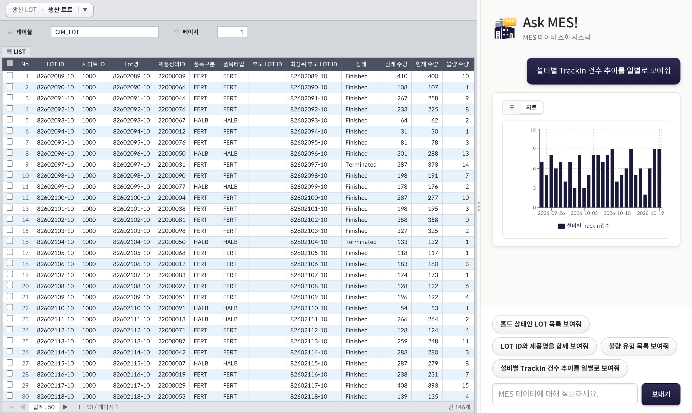
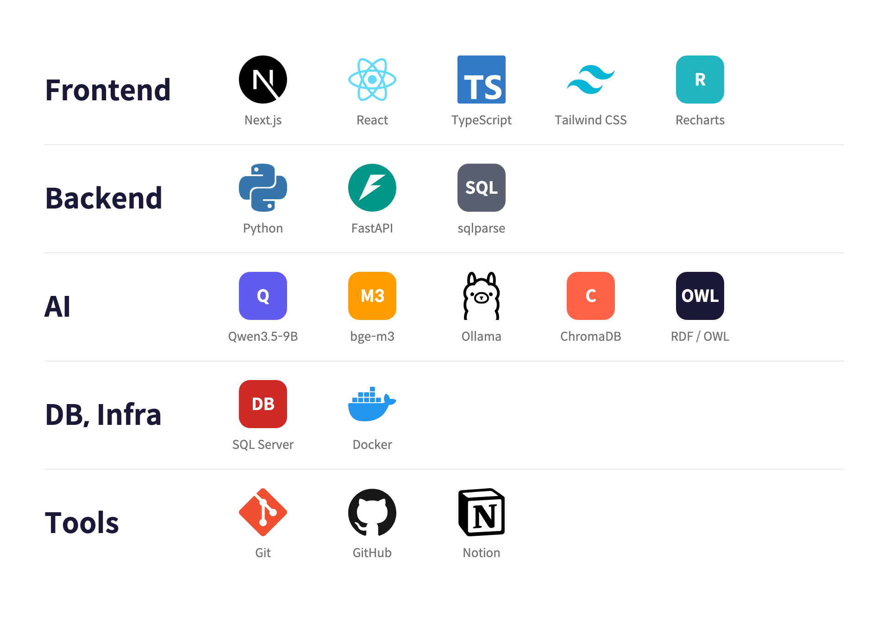
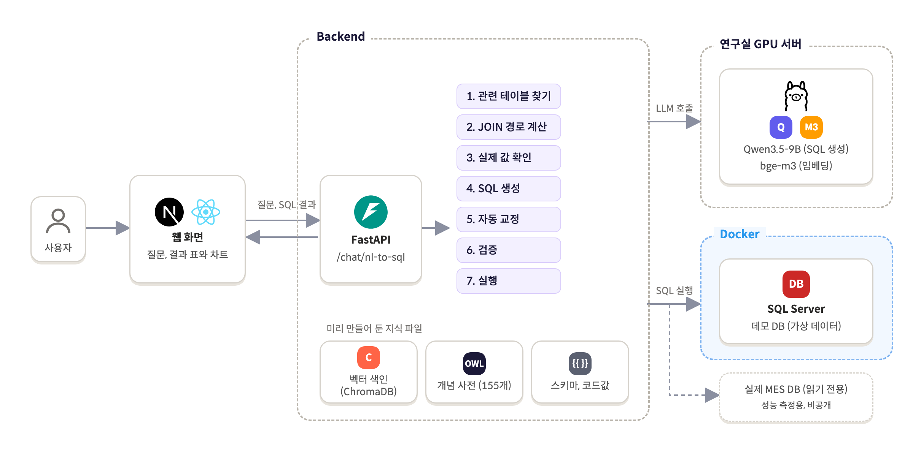
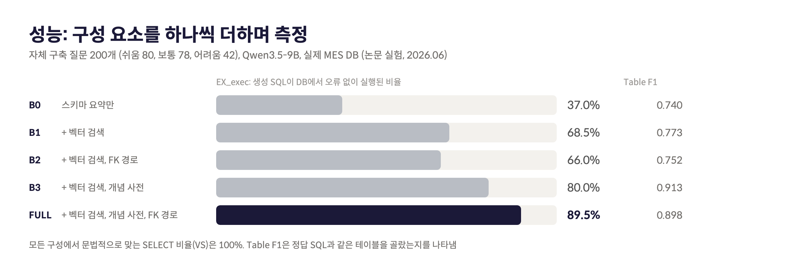

# NeuroFactory

자연어 질문을 SQL로 바꿔 MES(제조실행시스템) DB를 조회하는 시스템

공개용 데모는 가상 데이터 기반으로 동작한다.

| 기간 | 구분 | 역할 |
|------|------|------|
| 2026.03 ~ 2026.06 | 스마트팩토리 캡스톤디자인 (팀) | AI, BE, FE |

- 논문 투고: NeuroFactory: Ontology-Grounded Hybrid RAG for Natural Language Querying in Manufacturing Execution Systems (IEEE BigData 2026, BD-SMDT 워크숍)
- 특허 출원: 사용자 정보를 이용한 자연어 질의 처리 장치 및 그 동작 방법 (10-2026-0182784, 2026.09.23)

<br>

## 목차

1. [주제](#-주제)
2. [주요 기능](#-주요-기능)
3. [기술 스택](#-기술-스택)
4. [구성도](#-구성도)
5. [성능](#-성능)
6. [폴더 구조](#-폴더-구조)
7. [로컬 실행](#-로컬-실행)

<br>

## 🎯 주제

SQL을 모르는 현업(라인 관리자, 품질 담당자)은 MES 데이터를 직접 꺼내 쓰지 못하고, 간단한 확인도 개발자를 거쳐야 했다.

- 데이터: 절삭공구 공장의 MES 공정 추적 기록, MS SQL Server, 19테이블 457컬럼 2.7억 행
- 제약: 데이터를 밖으로 내보낼 수 없는 온프레미스 환경이라 외부 API(GPT 등) 대신 공장 안에서 돌릴 수 있는 오픈 모델(Qwen3.5-9B)을 사용

어려웠던 점은 세 가지였다.

1. 현장 용어와 DB 이름이 다름 ("불량수량" vs `LOSSQTY`)
2. 필요한 테이블과 그 사이 JOIN 경로를 모델이 모름
3. 모델이 만든 SQL이 데이터를 해칠 수 있음 (삭제, 변경, 전체 스캔)

<br>

## 💡 주요 기능

#### 질문하면 SQL을 만들어 실행하고 결과를 표로 보여 줌



#### 날짜, 숫자 결과는 차트로 바꿔 볼 수 있음



왼쪽은 MES 화면처럼 표를 직접 둘러보는 영역, 오른쪽은 질문 영역이다. 가운데 경계선을 끌어 넓이를 조절한다.

<br>

## 🛠 기술 스택



<br>

## 📂 구성도



질문 하나는 `backend/app/pipeline.py` 의 `run_pipeline()` 에서 7단계를 순서대로 거친다. 웹 API 와 성능 측정이 같은 함수를 쓴다.

| 단계 | 하는 일 | 코드 |
|------|---------|------|
| 1. 관련 테이블 찾기 | 개념 사전(온톨로지) + 벡터 검색(bge-m3, ChromaDB) | `retrieval/` |
| 2. JOIN 경로 계산 | FK 그래프 최단 경로(Dijkstra) | `retrieval/` |
| 3. 실제 값 확인 | 찾은 테이블의 샘플 조회 | `sampling/` |
| 4. SQL 생성 | 1~3 을 프롬프트에 넣어 LLM 호출 | `generation/` |
| 5. 자동 교정 | 확정적인 문법 오류를 코드로 수정 | `autofix/` |
| 6. 검증 | 스키마, 코드값, 안전성 검사, 실패 시 오류를 넣어 1회 재생성 | `validation/` |
| 7. 실행 | 읽기 전용 계정으로 실행, 실패 시 DB 오류를 넣어 1회 재생성 | `execution/` |

<br>

## 📊 성능



같은 200문항을 현재 코드로 다시 측정한 결과. 실행할 때마다 LLM 응답과 DB 샘플이 조금씩 달라 수치가 흔들린다.

| 시점 | VS (%) | EX_exec (%) | Table F1 |
|------|--------|-------------|----------|
| 논문 (2026-06) | 100.0 | 89.5 | 0.898 |
| 현재 코드 (2026-10-24) | 100.0 | 93.0 ~ 95.0 | 0.848 ~ 0.854 |

EX_exec 는 정답 SQL 과 생성 SQL 이 모두 오류 없이 실행된 비율이다. 결과값 일치 여부는 보지 않는다. 자세한 내용은 `backend/eval/paper_results/README.md`.

<br>

## 📁 폴더 구조

```
backend/
├── app/
│   ├── main.py                FastAPI 진입점
│   ├── pipeline.py            1~7단계를 순서대로 호출
│   ├── config.py              설정값 (.env)
│   ├── routers/               웹 API (chat: 질문, data: 데이터 둘러보기)
│   ├── retrieval/             1~2단계: retriever, ontology_loader(개념 사전), fk_resolver(JOIN 경로)
│   ├── sampling/              3단계: live_sample
│   ├── generation/            4단계: prompts, llm, date_policy
│   ├── autofix/               5단계: sql_autofix
│   ├── validation/            6단계: sql_validator, query_safety, code_values, concept_alignment
│   └── execution/             7단계: sql_executor, demo_db
├── data/                      스키마, 온톨로지, 코드값, 벤치마크 질문 세트
└── eval/                      벤치마크 실행, 채점, 논문 원본 결과

demo-db/                       데모 DB (가상 데이터) 테이블 정의, 생성 스크립트
web/                           웹 화면 (Next.js, React, TypeScript)
img/                           README 그림
docker-compose.yml             데모 DB (SQL Server)
```

<br>

## ▶ 로컬 실행

Python 3.12, Node.js, Docker, Ollama(`qwen3.5:9b`, `bge-m3`) 필요.

```bash
# 1. 데모 DB
cp .env.example .env                                  # MSSQL_SA_PASSWORD 채우기
docker compose up -d
# demo-db/01_create_tables.sql, 02_create_reader.sql 실행 후
cd backend && ./venv/bin/python ../demo-db/generate_demo_data.py

# 2. 백엔드
cd backend
cp .env.example .env                                  # DEMO_DB_*, OLLAMA_URL 채우기
python3.12 -m venv venv && ./venv/bin/pip install -r requirements.txt
./venv/bin/uvicorn app.main:app --port 8001

# 3. 웹
cd web && npm install && npm run dev                  # http://localhost:3000
```

벤치마크

```bash
cd backend
./venv/bin/python eval/run_benchmark.py --preset FULL --execute
./venv/bin/python eval/score.py eval/results/latest.csv --by difficulty
```
