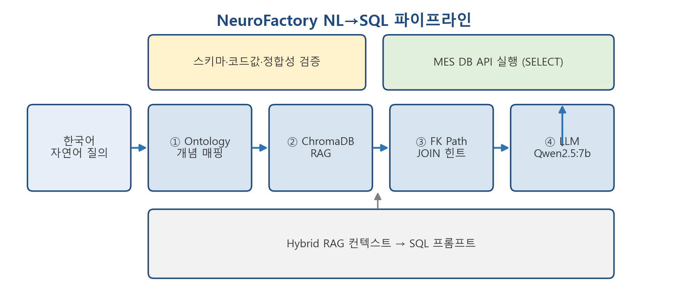
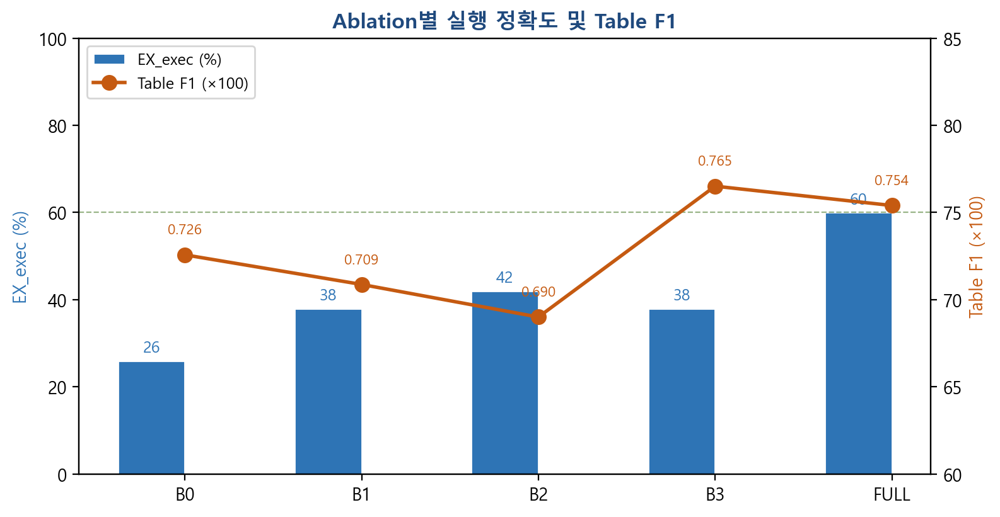
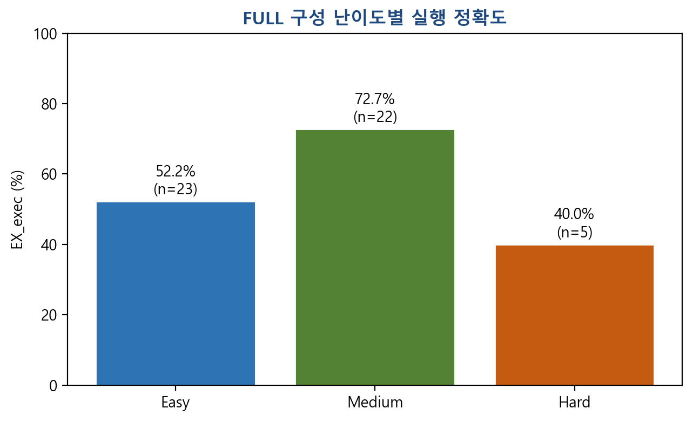
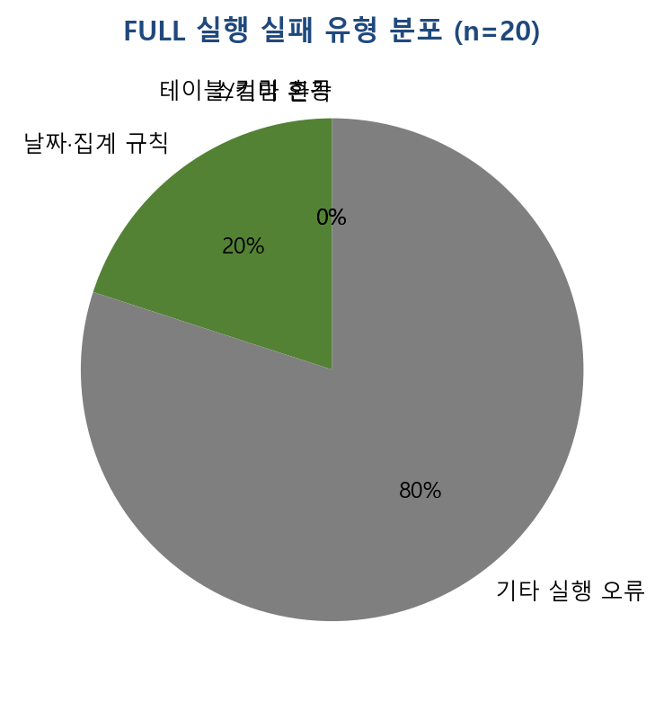

# MES 도메인 온톨로지 기반 Hybrid RAG를 활용한 자연어→SQL 변환 연구

**NeuroFactory: Ontology-Guided Hybrid RAG for Manufacturing Execution System NL-to-SQL**

---

**저자** 정병화  
**소속** (소속 기관명)  
**실험 일자** 2026년 6월 3일  
**프로젝트** NeuroFactory / THiRA MES 3.1.0 / SKKU-LS Tirayutech RISE (S-2026-0945-000)

---

## 초록 (Abstract)

제조실행시스템(MES) 현장에서는 비전문 사용자도 LOT·작업지시·설비·공정 실적 등을 자연어로 조회하고자 하는 요구가 증가하고 있다. 그러나 MES 스키마는 `CIM_*` 테이블이 다수이고 한국어 도메인 용어·외래키 관계가 복잡하여, 범용 대규모언어모델(LLM)만으로는 정확한 SQL 생성이 어렵다. 본 논문은 **Ontology-Guided Hybrid RAG** 기반 NL→SQL 시스템 **NeuroFactory**를 제안한다. 한국어 개념어를 MES 테이블·컬럼에 매핑하는 OWL 온톨로지, ChromaDB 벡터 스키마 검색, FK 그래프 JOIN 경로 힌트를 결합하여 LLM(Qwen2.5:7b) 프롬프트 컨텍스트를 구성한다. 자체 구축 벤치마크 50문항에 대한 ablation 실험(2026-06-03, 스키마·코드값 검증 적용) 결과, 제안 구성(FULL)은 **VS 100%**, **EX_exec 60%**로 ablation 중 최고였다. B0~B3는 26~42% 수준이며, Hybrid RAG·사전 검증의 필요성을 확인하였다.

**핵심어:** 제조실행시스템, 자연어→SQL, 온톨로지, 검색증강생성(RAG), 대규모언어모델, THiRA MES

---

# 1. 서론

## 1.1 연구 배경

제조실행시스템(Manufacturing Execution System, MES)은 생산 로트 추적, 작업지시 관리, 설비·공정 실적 수집 등 제조 현장의 핵심 정보시스템이다. THiRA MES 3.1.0과 같이 `CIM_LOT`, `CIM_PRODUCTORDER`, `CIM_PROCESSSEGMENT` 등 다수의 운영 테이블을 가진 환경에서는, 현업 사용자가 SQL을 직접 작성하지 않고 **한국어 자연어**로 데이터를 조회하려는 요구가 커지고 있다.

최근 LLM을 활용한 Text-to-SQL(NL→SQL) 연구가 활발하나, 공개 벤치마크(WikiSQL, Spider 등) 중심의 연구가 많고, **도메인 특화 스키마·한국어 질의·운영 DB 제약**(예: `WITH (NOLOCK)`, 사이트 ID)이 강한 MES 환경에 대한 실증은 상대적으로 부족하다. 벡터 검색(RAG)만으로는 “홀드”, “TrackIn”, “자재 LOT” 등 MES 용어와 테이블 매핑이 불완전하고, 다중 테이블 JOIN 경로를 LLM이 스스로 추론하기 어렵다.

## 1.2 연구 목적 및 기여

본 연구의 목적은 (1) MES 도메인 온톨로지와 FK·RAG를 결합한 **Hybrid RAG** 기반 NL→SQL 아키텍처를 제안하고, (2) 자체 벤치마크와 ablation 실험으로 각 구성요소의 기여도를 정량 검증하는 것이다.

1. THiRA MES `CIM_*` 스키마와 한국어 개념어를 연결하는 **OWL 온톨로지** 및 개념 사전 구축  
2. 온톨로지·ChromaDB RAG·FK JOIN 힌트를 통합한 **NeuroFactory** 프로토타입  
3. 50문항 골드 벤치마크와 **VS·EX_exec·Table F1** 기반 실행 평가, B0~FULL ablation  
4. MES 현장 적용 가능성 실증(VS 100%, EX_exec 60%)

## 1.3 논문 구성

2장 관련 연구, 3장 제안 방법(그림 1), 4장 실험 및 결과(그림 2~5), 5장 논의, 6장 결론 순으로 기술한다.

---

# 2. 관련 연구

## 2.1 Text-to-SQL

Text-to-SQL은 자연어 질의를 관계형 DB 질의로 변환하는 문제이다. Spider, WikiSQL 등에서 높은 정확도가 보고되나, 스키마 규모·도메인 용어·DB 방언 등 운영 환경과의 괴리가 존재한다.

## 2.2 RAG와 스키마 링킹

RAG는 검색된 스키마 청크를 LLM에 주입한다. FK 관계 그래프와 JOIN 경로 추론(**스키마 링킹**) 연구도 있으며, 본 연구는 MES FK 그래프와 Dijkstra 최단 경로로 구현한다.

## 2.3 온톨로지

제조 영역 온톨로지 표준(ISO 18629, ISA-95 등)이 논의되었다. 본 연구는 THiRA MES 운영 테이블에 맞춘 **경량 OWL**과 JSON 개념 사전을 병행한다.

## 2.4 본 연구의 위치

MES 운영 DB **실행 기반 평가**와 **온톨로지·FK·RAG ablation**에 초점을 둔다.

---

# 3. 제안 방법

## 3.1 시스템 개요

**NeuroFactory**는 한국어 질의를 MS SQL `SELECT`로 변환하고 MES REST API로 실행한다.

| 단계 | 모듈 | 역할 |
|:----:|------|------|
| ① | OntologyEngine | 한국어 개념어 → `CIM_*` 테이블·컬럼 |
| ② | ChromaDB RAG | 스키마 청크 벡터 검색 (top-k=6) |
| ③ | FKPathResolver | Dijkstra JOIN 경로 힌트 |
| ④ | LLM | Qwen2.5:7b SQL 생성 → MES API |

**[그림 1] NeuroFactory NL→SQL 처리 파이프라인**

그림 1은 한국어 질의부터 MES DB 실행까지의 4단계 Hybrid RAG 파이프라인과 SQL 사후 검증 단계를 나타낸다.

## 3.2 MES 도메인 온톨로지

`mes_ontology.ttl`(OWL)과 `mes_concept_map.json`으로 홀드·불량·TrackIn·작업지시 등을 테이블에 매핑한다. `mapsToTable`, `skos:altLabel` 속성을 사용한다.

## 3.3 Hybrid RAG

`retrieve_context()`가 개념 매핑·벡터 검색·JOIN 힌트를 조합한다. `RetrievalConfig`로 B0~FULL ablation을 제어한다.

## 3.4 SQL 생성 규칙

`SELECT`만 허용, `WITH (NOLOCK)`, 날짜 미지정 시 기준일 1년 전, 불량률·TrackIn 집계 규칙을 프롬프트에 명시한다.

---

# 4. 실험 및 결과

---

## 4.1.1 실험 목적

본 절에서는 제안한 **Ontology-Guided Hybrid RAG** 기반 MES 자연어→SQL(NL→SQL) 시스템(NeuroFactory)의 성능을 정량적으로 평가하기 위한 실험 환경, 벤치마크 데이터셋, 비교 구성(ablation), 평가 절차를 기술한다. 실험의 목적은 (1) 온톨로지·FK JOIN 힌트·벡터 RAG 각 구성요소의 기여도를 분리하여 측정하고, (2) 제안 구성(FULL)의 실행 기반 정확도를 MES 도메인 벤치마크에서 확인하는 것이다.

---

## 4.1.2 대상 시스템 및 데이터베이스

실험 대상은 THiRA MES 3.1.0 계열 제조실행시스템의 운영 스키마이며, 물리 테이블은 `CIM_*` 접두사를 사용한다. 주요 도메인은 생산 로트(`CIM_LOT`), 작업지시(`CIM_PRODUCTORDER`), 설비(`CIM_EQUIPMENT`), 공정 세그먼트·노드·경로(`CIM_PROCESSSEGMENT`, `CIM_PROCESSNODE`, `CIM_PROCESSPATH`), 자재·제품 정의, 배치·LOT 관계 등 공정관리 전반을 포함한다.

NL→SQL 파이프라인은 다음 4단계로 구성된다.

1. **개념 매핑**: OWL 온톨로지(`mes_ontology.ttl`) 및 JSON 개념 사전(`mes_concept_map.json`)을 이용하여 한국어 질의에서 관련 테이블·컬럼 후보를 식별한다.
2. **벡터 검색(RAG)**: ChromaDB에 시딩된 `mes_schema.json` 기반 스키마 청크에서 의미적으로 유사한 top-k개 문서를 검색한다.
3. **JOIN 경로 추론**: FK 그래프 기반 Dijkstra 최단 경로로 식별된 테이블 간 JOIN 힌트를 생성한다.
4. **SQL 생성**: LLM이 스키마·개념·JOIN 컨텍스트를 프롬프트에 포함하여 MS SQL Server용 `SELECT` 문을 생성하고, MES DB API를 통해 실행한다.

---

## 4.1.3 벤치마크 데이터셋

### 구성

자체 구축 벤치마크 **MES-NL2SQL-Gold v2**를 사용하였다. 파일은 `data/benchmark/mes_nl2sql_gold_v1.jsonl`(20문항 파일럿)에서 확장한 **50문항**(`mes_nl2sql_gold_v2.jsonl`)이며, 각 문항은 JSON Lines 형식으로 다음 필드를 포함한다.

| 필드 | 설명 |
|------|------|
| `id` | 문항 ID (Q001–Q050) |
| `question` | 한국어 자연어 질의 |
| `gold_sql` | 정답 MS SQL (`WITH (NOLOCK)` 포함) |
| `tables` | 참조 테이블 목록 (Table F1 평가용) |
| `difficulty` | easy / medium / hard |
| `query_type` | list, filter, aggregate, timeseries |
| `requires_join` | JOIN 필요 여부 |

### 문항 분포

**[표 1] 벤치마크 v2 문항 분포 (n=50)**

| 구분 | 항목 | 개수 |
|------|------|------|
| 난이도 | Easy | 23 |
| | Medium | 22 |
| | Hard | 5 |
| 질의 유형 | 목록(list) | 18 |
| | 필터(filter) | 14 |
| | 집계(aggregate) | 14 |
| | 시계열(timeseries) | 4 |
| JOIN | 필요 | 18 |
| | 불필요 | 32 |

**[그림 2] MES-NL2SQL-Gold v2 벤치마크 문항 분포**

문항은 (1) 시스템 README의 대표 질의, (2) `mes_concept_map.json`의 도메인 개념(홀드, 불량, TrackIn/Out, 공정, 배치 등), (3) 공정관리 ERD 기반 테이블 관계를 반영하여 작성·교차 검토하였다.

### 골드 SQL 검증

실험 전 모든 골드 SQL에 대해 MES DB API 실행 검증을 수행하였다(`validate_gold.py`). 검증 결과 **50/50 문항(100%)** 이 오류 없이 실행되었으며, 이를 4장 EX_exec 평가의 기준(골드 측 실행 성공)으로 사용하였다.

---

## 4.1.4 소프트웨어 및 하드웨어 환경

**[표 2] 실험 소프트웨어 환경**

| 항목 | 설정 |
|------|------|
| 구현 | Python 3.11, FastAPI (MES LLM API) |
| LLM | Ollama **Qwen2.5:7b** (로컬 추론) |
| LLM 온도 | 0.05 (SQL 생성) |
| 최대 토큰 | 512 (SQL 생성) |
| RAG | ChromaDB + 기본 임베딩, **top-k = 6** |
| 온톨로지 | OWL/Turtle `mes_ontology.ttl`, rdflib SPARQL |
| 스키마 지식 | `mes_schema.json` (CIM_* 테이블·컬럼·FK) |
| DB 실행 | MES REST API (`POST /api/mes/query`), 결과 상한 100행 |
| SQL 방언 | MS SQL Server (`WITH (NOLOCK)`, `TOP`, `DATEADD` 등) |

하드웨어는 연구용 워크스테이션에서 Ollama 로컬 추론을 수행하였다(운영체제: Windows 10/11). MES DB는 API 게이트웨이를 통해 원격 MSSQL에 접근하였다. 네트워크 터널 URL·API 키는 실험 기간 중 고정하여 사용하였다.

### 프롬프트 규칙 (공통)

SQL 생성 프롬프트에는 MES 도메인 규칙을 명시하였다. 예: `SELECT`만 허용, 모든 테이블에 `WITH (NOLOCK)` 적용, 사용자가 날짜를 지정하지 않으면 **기준일을 1년 전(`DATEADD(year, -1, GETDATE())`)** 으로 하는 날짜 규칙, 불량률은 `LOSSQTY`/`ORIGINALQTY` 기반 계산, 설비 가동 추이는 `RUNCOUNT` 대신 `TRACKINTIME` 집계 등. 이는 운영 MES 질의 패턴과 LLM 환각을 줄이기 위한 것이다.

---

## 4.1.5 Ablation 설계

온톨로지·FK·RAG의 기여도를 분리하기 위해 5가지 검색 구성을 비교하였다. 구현은 `core/retriever.py`의 `RetrievalConfig` 프리셋으로 제어하였다.

**[표 3] Ablation 구성 (Preset)**

| Preset | ChromaDB RAG | 온톨로지 개념 매핑 | FK JOIN 힌트 | 설명 |
|--------|:------------:|:------------------:|:------------:|------|
| **B0** | ✗ | ✗ | ✗ | 테이블·PK 요약만 제공 (베이스라인) |
| **B1** | ✓ | ✗ | ✗ | 벡터 스키마 검색만 |
| **B2** | ✓ | ✗ | ✓ | RAG + FK 최단 JOIN 경로 |
| **B3** | ✓ | ✓ | ✗ | RAG + 온톨로지(한국어 개념어→테이블) |
| **FULL** | ✓ | ✓ | ✓ | **제안 구성** (전체 Hybrid RAG) |

동일 50문항·동일 LLM·동일 프롬프트 템플릿을 사용하고, 검색 컨텍스트 구성만 위 표와 같이 변경하였다.

---

## 4.1.6 실험 절차

실험은 다음 순서로 수행하였다.

1. **골드 검증**: `eval/validate_gold.py`로 50문항 gold SQL 실행 확인.
2. **Ablation 실행**: `eval/run_all_ablations.py --execute`로 B0→B1→B2→B3→FULL 순차 실행, 문항별 생성 SQL 및 DB 실행 결과를 CSV로 저장.
3. **사전 검증**: 생성 SQL에 대해 `mes_schema.json` 화이트리스트, `mes_code_values.json` 코드값, 질의-테이블 정합성 검사 후 실패 시 LLM 1회 재시도.
4. **지표 산출**: `eval/score.py`로 VS, EX_exec, EX_strict, Table F1 및 난이도별 집계.
5. **비교표 생성**: `eval/report.py`로 ablation 요약표(`paper_table.md`) 생성.

각 문항에 대해 EX_exec는 “골드 SQL 실행 성공 **AND** 생성 SQL 실행 성공”을 만족할 때 1로 기록하였다. 생성 SQL이 문법적으로 유효하나 스키마에 없는 테이블·컬럼을 참조한 경우 DB API 500 오류로 실패하는 사례가 다수 관측되었다(4.5절).

---

## 4.1.7 재현성 (Reproducibility)

실험 재현을 위해 다음 산출물을 버전 관리하였다.

| 산출물 | 경로 |
|--------|------|
| 벤치마크 골드 | `data/benchmark/mes_nl2sql_gold_v2.jsonl` |
| 온톨로지 | `data/mes_ontology.ttl` |
| 스키마·개념 사전 | `data/mes_schema.json`, `data/mes_concept_map.json` |
| 실험 결과 | `eval/results/experiment_20260603_182753/` |
| 실행 가이드 | `eval/PAPER_EXPERIMENT.md` |

동일 환경에서 `python eval/run_all_ablations.py --execute` 및 `python eval/score.py`로 표 1·표 2 수치를 재현할 수 있다. MES API URL·API 키는 보안상 논문 본문에 기재하지 않으며, 실험 환경 설명에 “REST API 경유 MSSQL 접근” 수준으로 기술한다.

---

## 4.2.1 평가 지표

본 연구에서는 자연어→SQL 변환 품질을 다음 지표로 측정하였다.

- **VS (Valid SQL)**: 생성된 SQL이 `SELECT` 문이며 금지 연산(INSERT/UPDATE/DELETE 등)을 포함하지 않는 비율.
- **EX_exec (Execution Accuracy)**: 골드 SQL과 생성 SQL이 **모두** MES DB API를 통해 오류 없이 실행된 비율. NL→SQL 연구에서 일반적으로 사용하는 실행 기반 정확도에 해당한다.
- **Table F1**: 생성 SQL이 참조한 `CIM_*` 테이블 집합과 골드 SQL의 테이블 집합 간 F1 점수(평균).
- **EX_strict**: 골드 SQL과 생성 SQL의 문자열이 완전히 일치하는 비율. 의미적으로 동일하더라도 표현이 다르면 0으로 계산되므로, 본 실험에서는 참고 지표로만 기록하였다.

골드 SQL 50문항은 사전에 `validate_gold.py`로 검증하였으며, 실행 성공률은 **100%**(50/50)였다.

---

## 4.2.2 Ablation 실험 결과

표 4는 검색·지식 구성요소별 ablation 결과이다. LLM은 Ollama **Qwen2.5:7b**, RAG top-k=6, 벤치마크 문항 수 **n=50**이다.

**[표 4] Ablation별 NL→SQL 성능 비교**

| 구성 (Preset) | 설명 | VS (%) | EX_exec (%) | Table F1 |
|---------------|------|--------|-------------|----------|
| B0 | 스키마 요약만 | 100.0 | 26.0 | 0.726 |
| B1 | + ChromaDB RAG | 100.0 | 38.0 | 0.709 |
| B2 | + FK JOIN 힌트 | 100.0 | 42.0 | 0.690 |
| B3 | + 온톨로지 개념 매핑 | 100.0 | 38.0 | 0.765 |
| **FULL** | RAG + FK + 온톨로지 (제안) | 100.0 | **60.0** | 0.754 |

표 4에 따르면, 제안 구성(FULL)은 **VS 100%**, **EX_exec 60.0%**로 **가장 높은 실행 정확도**를 달성하였다. 모든 구성에서 VS는 100%로, 스키마 검증·재시도 적용 후에도 유효 `SELECT` 생성은 안정적이었다.

EX_exec 측면에서 FULL(60.0%) > B2(42.0%) > B1·B3(38.0%) > B0(26.0%) 순이었다. B1은 이전 실험(검증 미적용) 대비 0%에서 38%로 개선되었으나, RAG 단독으로는 여전히 부족하다. B2는 FK 힌트가 JOIN 질의에 기여하나 FULL보다 낮아, 온톨로지·RAG와의 **조합(FULL)** 이 실행 성공률에 유리함을 보였다. B3는 Table F1(0.765)이 가장 높아 온톨로지가 테이블 식별에 기여함을 시사한다.

EX_strict는 모든 구성에서 **0%**였다. 이는 동일 의미의 질의라도 alias, 컬럼 순서, `TOP` 절 등 표현 차이가 크기 때문이며, 본 논문에서는 실행 기반 지표(EX_exec)를 주 평가 기준으로 삼았다.

**[그림 3] Ablation별 EX_exec 및 Table F1**

그림 3에서 FULL은 EX_exec 60%로 최고이며, B3는 Table F1이 가장 높아 온톨로지가 테이블 식별에 기여함을 시각적으로 확인할 수 있다.

---

## 4.2.3 난이도별 결과 (FULL)

표 2는 제안 구성(FULL)에서 문항 난이도별 EX_exec이다.

**[표 5] 난이도별 성능 (FULL, n=50)**

| 난이도 | 문항 수 (n) | VS (%) | EX_exec (%) |
|--------|-------------|--------|-------------|
| Easy | 23 | 100.0 | 52.2 |
| Medium | 22 | 100.0 | 72.7 |
| Hard | 5 | 100.0 | 40.0 |

Medium(72.7%)이 가장 높고 Easy(52.2%), Hard(40.0%) 순이었다. Hard는 시계열·복합 JOIN·개발 DB 날짜 기준(`MES_DATE_MODE=dev_last_year`) 질의에서 오류가 상대적으로 많다.

**[그림 4] FULL 구성 난이도별 EX_exec**

---

## 4.2.4 오류 유형 요약 (대표 사례)

FULL 구성에서 EX_exec 실패(20문항)의 대표 유형은 다음과 같다.

**[표 6] 실행 실패 대표 사례 (FULL)**

| ID | 질의 요약 | 오류 유형 | 설명 |
|----|-----------|-----------|------|
| Q008 | 안전재고 자재 | 존재하지 않는 테이블 | `CIM_MATERIAL` 등 스키마에 없는 객체 참조 |
| Q007 | 자재 LOT 수량 0 | 테이블 혼동 | `CIM_MATERIALLOT` 대신 `CIM_LOT` 조회 |
| Q005 | 작업지시 목록 | 잘못된 컬럼/JOIN | `ORDERID` 등 미정의 컬럼, 불필요 JOIN |
| Q020 | 설비별 TrackIn 일별 | 날짜 규칙 위반 | 기준일 1년 전 규칙 미적용 |
| Q018 | 공정 노드 목록 | 스키마 오류 | `NODENAME` 등 미존재 컬럼, 잘못된 JOIN 경로 |

위 사례는 온톨로지·FK 힌트가 있어도 LLM이 환각(hallucination) 테이블을 생성하거나 프롬프트 규칙을 일부 무시할 수 있음을 보여준다. 향후에는 스키마 화이트리스트 검증, SQL 사후 검증, 온톨로지–FK 가중치 조정 등을 통한 개선이 필요하다.

**[그림 5] FULL 실행 실패 유형 분포**

---

> 선행 절: `PAPER_SECTION_4_2_DRAFT.md`, `PAPER_SECTION_4_3_DRAFT.md`  
> 실험: 2026-06-03, n=50, experiment_20260603_182753 (스키마·코드값 검증 적용)

---

# 5. 논의

## 5.1 실험 결과의 의미

본 연구에서 제안한 Ontology-Guided Hybrid RAG 기반 NL→SQL 시스템은 50문항 MES 벤치마크에서 **유효 SQL 생성률(VS) 100%**, **실행 정확도(EX_exec) 60%**를 달성하였다. VS가 모든 ablation 구성에서 98% 이상인 점은, 로컬 LLM(Qwen2.5:7b)이 MES 질의에 대해 기본적으로 `SELECT` 형태의 질의문을 생성할 수 있음을 보여준다. 한편 EX_exec가 60%에 머문 것은, 문법적으로 유효한 SQL이라도 **스키마에 존재하지 않는 테이블·컬럼 참조**, **부적절한 JOIN**, **프롬프트 날짜 규칙 미준수** 등으로 실제 DB 실행이 실패하기 때문이다. 따라서 MES NL→SQL에서는 “문법적 유효성”과 “도메인·스키마 정합성”을 분리하여 평가해야 하며, 본 연구는 후자를 EX_exec로 측정하였다.

실행 기반 평가에서 EX_strict(문자열 일치)가 전 구성에서 0%였던 것은 자연스러운 결과이다. 동일 의미의 질의라도 `TOP` 유무, alias, 컬럼 순서, JOIN 순서 등이 달라질 수 있으며, NL→SQL 연구에서도 실행 정확도를 주 지표로 삼는 경우가 많다. 본 논문의 논의는 EX_exec 및 Table F1 중심으로 전개한다.

---

## 5.2 Ablation 결과 해석

### (1) FK JOIN 힌트(B2)와 FULL 조합

**B2(RAG+FK)** 는 EX_exec **42.0%**, **FULL(RAG+FK+온톨로지)** 은 **60.0%**로, 제안 구성이 ablation 중 최고였다. FK JOIN 힌트는 다중 테이블 질의에서 조인 추론을 돕지만, 온톨로지·코드값·질의-테이블 검증과 함께 쓸 때 실행 성공률이 더 높아졌다. MES 스키마는 `CIM_LOT`–`CIM_PRODUCTORDER`–`CIM_EQUIPMENT` 등 관계가 복잡하여, RAG만으로는 JOIN·도메인 매핑이 불안정하다.

### (2) 온톨로지(B3)의 역할

**B3(RAG+온톨로지)** 는 EX_exec 38.0%이나 **Table F1(0.765)** 이 가장 높았다. 한국어 개념(홀드, 자재 LOT, 공정 구역 등)을 `CIM_*`에 매핑하는 온톨로지는 **관련 테이블 식별**에 유효하나, JOIN 경로·코드값 검증 없이는 실행 성공까지 이어지기 어렵다.

### (3) RAG 단독(B1)의 한계

**B1(RAG만)** 은 EX_exec **38.0%**로, 검증·재시도 적용 시에도 RAG 단독은 FULL보다 낮았다. 도메인 개념(자재 LOT vs 생산 LOT) 구분에는 온톨로지·규칙 기반 검증이 보완재로 필요함을 뒷받침한다.

### (4) 베이스라인(B0)

B0(스키마 요약만)은 EX_exec 18.0%로, 테이블 목록 수준의 정보만으로는 JOIN·필터 조건이 포함된 질의를 처리하기 어렵다. 그럼에도 일부 단순 질의에서는 동작하여, 최소한의 스키마 노출은 필수적이다.

---

## 5.3 오류 유형 및 개선 방향

4.5절의 대표 실패 사례를 종합하면, 오류는 다음 네 유형으로 분류된다.

| 유형 | 설명 | 대표 문항 |
|------|------|-----------|
| 스키마 환각 | 존재하지 않는 테이블·컬럼 생성 | Q008 (`CIM_MATERIAL`), Q018 (`NODENAME`) |
| 테이블 혼동 | 유사 개념의 잘못된 테이블 선택 | Q007 (자재 LOT→`CIM_LOT`) |
| 과잉·부적절 JOIN | 불필요 다중 JOIN, 미정의 FK 가정 | Q005, Q006, Q015 |
| 규칙 미준수 | 날짜·집계 규칙 위반 | Q020 (기준일 1년 전) |

개선 방향은 다음과 같다.  
(1) **SQL 사후 검증**: 생성 SQL의 테이블·컬럼을 `mes_schema.json` 화이트리스트와 대조.  
(2) **컨텍스트 정책**: FK JOIN 힌트 우선, 온톨로지는 테이블 후보 제한용으로 역할 분리.  
(3) **벤치마크 확장**: StoredQuery·현장 질의 기반 80~100문항, Hard 비중 확대.  
(4) **골드·평가 고도화**: 결과 집합 동등성 비교, 시맨틱 EX 지표 도입.

---

## 5.4 연구의 한계

본 실험에는 다음 한계가 있다.

1. **벤치마크 규모**: 50문항은 파일럿·학위 논문 1차 실험에는 적합하나, 산업 현장 전체 질의 분포를 대표하기에는 제한적이다.  
2. **단일 LLM·단일 사이트**: Qwen2.5:7b 로컬 1종만 사용하였으며, `SITEID`·코드값(`STATE`, `ISHOLD` 등)은 특정 운영 환경에 의존한다.  
3. **개발 DB 날짜 기준**: 평가는 `MES_DATE_MODE=dev_last_year`(1년 전 구간)이며, 운영 DB에서는 `production` 모드로 전환 필요.  
4. **EX_strict 미사용**: 의미적으로 동등한 SQL은 평가에서 성공으로 인정하지 않았다.  
5. **보안·운영 요소**: API 키·터널 URL 등 실험 인프라는 논문에 상세 기재하지 않았다.

이러한 한계는 향후 다기관·다모델 실험과 현장 파일럿으로 보완할 수 있다.

---

## 5.5 기존 연구와의 차별점 (요약 문단)

기존 Text-to-SQL 연구는 주로 공개 벤치마크(WikiSQL, Spider 등)를 대상으로 하며, 제조 MES처럼 **도메인 특화 스키마·한국어 질의·운영 DB 제약(`NOLOCK`, 사이트 ID)** 이 강한 환경은 상대적으로 덜 다루어졌다. 본 연구는 (1) THiRA MES `CIM_*` 스키마에 맞춘 OWL 온톨로지, (2) FK 그래프와 온톨로지를 결합한 Hybrid RAG, (3) 실행 기반 평가와 ablation을 통한 구성요소 분석을 제시한다는 점에서 차별된다.

---

# 6. 결론

## 6.1 연구 요약

본 논문은 제조 실행 시스템(MES) 환경에서 현업 사용자의 한국어 자연어 질의를 SQL로 변환하기 위한 **Ontology-Guided Hybrid RAG** 기반 NL→SQL 접근을 제안하고, NeuroFactory 프로토타입과 50문항 벤치마크로 유효성을 검증하였다. 시스템은 온톨로지 기반 개념 매핑, ChromaDB 벡터 스키마 검색, FK JOIN 경로 힌트, 로컬 LLM(Qwen2.5:7b)을 결합하여 MES DB API로 SQL을 실행한다.

## 6.2 주요 기여

본 연구의 기여는 다음과 같이 요약할 수 있다.

1. **MES 도메인 온톨로지 구축**: THiRA MES 3.1.0 공정관리 관련 `CIM_*` 테이블·한국어 개념어를 OWL(Turtle) 및 개념 사전으로 정리하고, NL→SQL 검색 컨텍스트에 활용하였다.

2. **Hybrid RAG 아키텍처**: RAG·FK·온톨로지·사전 검증을 ablation으로 분리·정량화하였고, FULL(EX_exec 60%)이 단일 구성 중 최고였다.

3. **실행 기반 벤치마크 절차**: 골드 SQL 사전 검증(100%), VS·EX_exec·Table F1 지표, B0~FULL ablation, 재현 가능한 평가 스크립트(`eval/`)를 제시하였다.

4. **실증 결과**: 제안 구성(FULL)에서 VS 100%, EX_exec 60%를 달성하여, MES 현장 질의 지원 도구로서의 가능성을 보였다.

## 6.3 시사점

실험 결과는 MES NL→SQL에서 **구조적 지식(FK)** 과 **의미적 지식(온톨로지)** 이 모두 필요하나, 단순히 모두 넣는다고 항상 최적 성능이 나오지는 않음을 보여준다. 현장 도입 시에는 (1) FK JOIN 힌트를 핵심으로 하고, (2) 온톨로지로 테이블 후보를 좁힌 뒤, (3) SQL 화이트리스트 검증을 적용하는 **단계적 파이프라인**이 실용적일 수 있다. 또한 VS 100%와 EX_exec 60%의 격차는, LLM 교육·프롬프트만으로는 부족하고 **스키마 정합성 검증 레이어**가 필수임을 시사한다.

## 6.4 향후 연구

향후 다음을 진행할 계획이다.

- 벤치마크를 80~100문항으로 확장하고, 현장 StoredQuery·대시보드 질의를 반영한다.  
- FULL 대비 **FK-우선(FK-first)** 컨텍스트 조립 전략을 설계·비교한다.  
- 생성 SQL에 대한 **스키마 화이트리스트·결과 동등성** 기반 자동 재시도를 도입한다.  
- 다양한 오픈 LLM 및 한국어 특화 모델에 대한 교차 실험을 수행한다.  
- 공정관리 외 품질·설비보전(SPC, PMS) 도메인으로 온톨로지·벤치마크를 확장한다.

---
---

# 참고문헌

1. Yu, T., et al. (2018). Spider. EMNLP.  
2. Karpukhin, V., et al. (2020). Dense Passage Retrieval. EMNLP.  
3. Lewis, P., et al. (2020). RAG for Knowledge-Intensive NLP. NeurIPS.  
4. THiRA MES 3.1.0 ERD 공정관리 (내부 문서).  

---

# 부록

- 실험 결과: `eval/results/experiment_20260603_182753/`  
- 벤치마크: `data/benchmark/mes_nl2sql_gold_v2.jsonl`  
- 그림 생성: `python eval/figures/generate_paper_figures.py`  
- 완성본 일괄: `python eval/build_paper_complete.py`  
- Word 생성: `python eval/make_paper_full_docx.py`

---

*통합본 v2 — `python eval/merge_paper_sections.py` 로 재생성*
