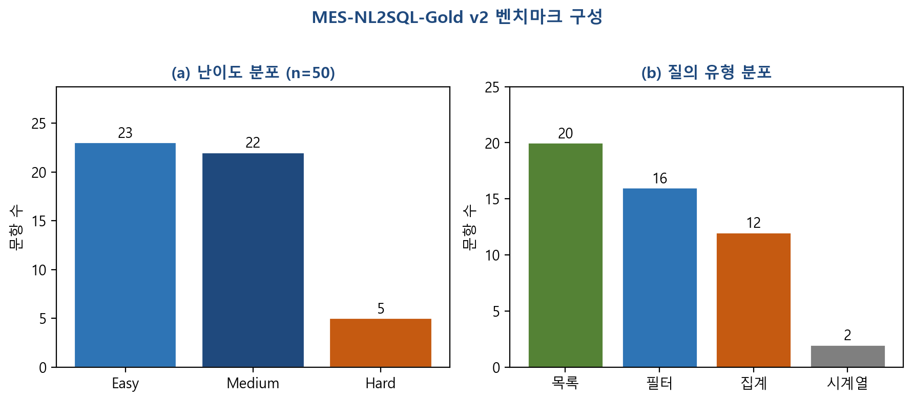

# 4.2 실험 환경 및 설계 (논문 초안용 — hwp 붙여넣기)

> 4.3절 결과 초안: `eval/PAPER_SECTION_4_3_DRAFT.md`  
> 실험 일자: 2026-06-02

---

## 4.2.1 실험 목적

본 절에서는 제안한 **Ontology-Guided Hybrid RAG** 기반 MES 자연어→SQL(NL→SQL) 시스템(NeuroFactory)의 성능을 정량적으로 평가하기 위한 실험 환경, 벤치마크 데이터셋, 비교 구성(ablation), 평가 절차를 기술한다. 실험의 목적은 (1) 온톨로지·FK JOIN 힌트·벡터 RAG 각 구성요소의 기여도를 분리하여 측정하고, (2) 제안 구성(FULL)의 실행 기반 정확도를 MES 도메인 벤치마크에서 확인하는 것이다.

---

## 4.2.2 대상 시스템 및 데이터베이스

실험 대상은 THiRA MES 3.1.0 계열 제조실행시스템의 운영 스키마이며, 물리 테이블은 `CIM_*` 접두사를 사용한다. 주요 도메인은 생산 로트(`CIM_LOT`), 작업지시(`CIM_PRODUCTORDER`), 설비(`CIM_EQUIPMENT`), 공정 세그먼트·노드·경로(`CIM_PROCESSSEGMENT`, `CIM_PROCESSNODE`, `CIM_PROCESSPATH`), 자재·제품 정의, 배치·LOT 관계 등 공정관리 전반을 포함한다.

NL→SQL 파이프라인은 다음 4단계로 구성된다.

1. **개념 매핑**: OWL 온톨로지(`mes_ontology.ttl`) 및 JSON 개념 사전(`mes_concept_map.json`)을 이용하여 한국어 질의에서 관련 테이블·컬럼 후보를 식별한다.
2. **벡터 검색(RAG)**: ChromaDB에 시딩된 `mes_schema.json` 기반 스키마 청크에서 의미적으로 유사한 top-k개 문서를 검색한다.
3. **JOIN 경로 추론**: FK 그래프 기반 Dijkstra 최단 경로로 식별된 테이블 간 JOIN 힌트를 생성한다.
4. **SQL 생성**: LLM이 스키마·개념·JOIN 컨텍스트를 프롬프트에 포함하여 MS SQL Server용 `SELECT` 문을 생성하고, MES DB API를 통해 실행한다.

---

## 4.2.3 벤치마크 데이터셋

### 구성

자체 구축 벤치마크 **MES-NL2SQL-Gold v2**를 사용하였다. 파일은 `data/benchmark/mes_nl2sql_gold_v1.jsonl`(20문항 파일럿)에서 확장한 **50문항**(`mes_nl2sql_gold_v2.jsonl`)이며, 각 문항은 JSON Lines 형식으로 다음 필드를 포함한다.

| 필드 | 설명 |
|------|------|
| `id` | 문항 ID (Q001–Q050) |
| `question` | 한국어 자연어 질의 |
| `gold_sql` | 정답 MS SQL (`WITH (NOLOCK)` 포함) |
| `tables` | 참조 테이블 목록 (Table F1 평가용) |
| `difficulty` | easy / medium / hard |
| `query_type` | list, filter, aggregate, timeseries |
| `requires_join` | JOIN 필요 여부 |

### 문항 분포

**[표 A] 벤치마크 v2 문항 분포 (n=50)**

| 구분 | 항목 | 개수 |
|------|------|------|
| 난이도 | Easy | 23 |
| | Medium | 22 |
| | Hard | 5 |
| 질의 유형 | 목록(list) | 18 |
| | 필터(filter) | 14 |
| | 집계(aggregate) | 14 |
| | 시계열(timeseries) | 4 |
| JOIN | 필요 | 18 |
| | 불필요 | 32 |

**[그림 2] MES-NL2SQL-Gold v2 벤치마크 문항 분포**

문항은 (1) 시스템 README의 대표 질의, (2) `mes_concept_map.json`의 도메인 개념(홀드, 불량, TrackIn/Out, 공정, 배치 등), (3) 공정관리 ERD 기반 테이블 관계를 반영하여 작성·교차 검토하였다.

### 골드 SQL 검증

실험 전 모든 골드 SQL에 대해 MES DB API 실행 검증을 수행하였다(`validate_gold.py`). 검증 결과 **50/50 문항(100%)** 이 오류 없이 실행되었으며, 이를 4.3절 EX_exec 평가의 기준(골드 측 실행 성공)으로 사용하였다.

---

## 4.2.4 소프트웨어 및 하드웨어 환경

**[표 B] 실험 소프트웨어 환경**

| 항목 | 설정 |
|------|------|
| 구현 | Python 3.11, FastAPI (MES LLM API) |
| LLM | Ollama **Qwen2.5:7b** (로컬 추론) |
| LLM 온도 | 0.05 (SQL 생성) |
| 최대 토큰 | 512 (SQL 생성) |
| RAG | ChromaDB + 기본 임베딩, **top-k = 6** |
| 온톨로지 | OWL/Turtle `mes_ontology.ttl`, rdflib SPARQL |
| 스키마 지식 | `mes_schema.json` (CIM_* 테이블·컬럼·FK) |
| DB 실행 | MES REST API (`POST /api/mes/query`), 결과 상한 100행 |
| SQL 방언 | MS SQL Server (`WITH (NOLOCK)`, `TOP`, `DATEADD` 등) |

하드웨어는 연구용 워크스테이션에서 Ollama 로컬 추론을 수행하였다(운영체제: Windows 10/11). MES DB는 API 게이트웨이를 통해 원격 MSSQL에 접근하였다. 네트워크 터널 URL·API 키는 실험 기간 중 고정하여 사용하였다.

### 프롬프트 규칙 (공통)

SQL 생성 프롬프트에는 MES 도메인 규칙을 명시하였다. 예: `SELECT`만 허용, 모든 테이블에 `WITH (NOLOCK)` 적용, 사용자가 날짜를 지정하지 않으면 **기준일을 1년 전(`DATEADD(year, -1, GETDATE())`)** 으로 하는 날짜 규칙, 불량률은 `LOSSQTY`/`ORIGINALQTY` 기반 계산, 설비 가동 추이는 `RUNCOUNT` 대신 `TRACKINTIME` 집계 등. 이는 운영 MES 질의 패턴과 LLM 환각을 줄이기 위한 것이다.

---

## 4.2.5 Ablation 설계

온톨로지·FK·RAG의 기여도를 분리하기 위해 5가지 검색 구성을 비교하였다. 구현은 `core/retriever.py`의 `RetrievalConfig` 프리셋으로 제어하였다.

**[표 C] Ablation 구성 (Preset)**

| Preset | ChromaDB RAG | 온톨로지 개념 매핑 | FK JOIN 힌트 | 설명 |
|--------|:------------:|:------------------:|:------------:|------|
| **B0** | ✗ | ✗ | ✗ | 테이블·PK 요약만 제공 (베이스라인) |
| **B1** | ✓ | ✗ | ✗ | 벡터 스키마 검색만 |
| **B2** | ✓ | ✗ | ✓ | RAG + FK 최단 JOIN 경로 |
| **B3** | ✓ | ✓ | ✗ | RAG + 온톨로지(한국어 개념어→테이블) |
| **FULL** | ✓ | ✓ | ✓ | **제안 구성** (전체 Hybrid RAG) |

동일 50문항·동일 LLM·동일 프롬프트 템플릿을 사용하고, 검색 컨텍스트 구성만 위 표와 같이 변경하였다.

---

## 4.2.6 실험 절차

실험은 다음 순서로 수행하였다.

1. **골드 검증**: `eval/validate_gold.py`로 50문항 gold SQL 실행 확인.
2. **Ablation 실행**: `eval/run_all_ablations.py --execute`로 B0→B1→B2→B3→FULL 순차 실행, 문항별 생성 SQL 및 DB 실행 결과를 CSV로 저장.
3. **사전 검증**: 생성 SQL에 대해 `mes_schema.json` 화이트리스트, `mes_code_values.json` 코드값, 질의-테이블 정합성 검사 후 실패 시 LLM 1회 재시도.
4. **지표 산출**: `eval/score.py`로 VS, EX_exec, EX_strict, Table F1 및 난이도별 집계.
5. **비교표 생성**: `eval/report.py`로 ablation 요약표(`paper_table.md`) 생성.

각 문항에 대해 EX_exec는 “골드 SQL 실행 성공 **AND** 생성 SQL 실행 성공”을 만족할 때 1로 기록하였다. 생성 SQL이 문법적으로 유효하나 스키마에 없는 테이블·컬럼을 참조한 경우 DB API 500 오류로 실패하는 사례가 다수 관측되었다(4.3.4절).

---

## 4.2.7 재현성 (Reproducibility)

실험 재현을 위해 다음 산출물을 버전 관리하였다.

| 산출물 | 경로 |
|--------|------|
| 벤치마크 골드 | `data/benchmark/mes_nl2sql_gold_v2.jsonl` |
| 온톨로지 | `data/mes_ontology.ttl` |
| 스키마·개념 사전 | `data/mes_schema.json`, `data/mes_concept_map.json` |
| 실험 결과 | `eval/results/experiment_20260603_182753/` |
| 실행 가이드 | `eval/PAPER_EXPERIMENT.md` |

동일 환경에서 `python eval/run_all_ablations.py --execute` 및 `python eval/score.py`로 표 1·표 2 수치를 재현할 수 있다. MES API URL·API 키는 보안상 논문 본문에 기재하지 않으며, 실험 환경 설명에 “REST API 경유 MSSQL 접근” 수준으로 기술한다.

---

## hwp 붙여넣기 체크리스트 (4.2)

- [ ] 4.2.2 시스템 4단계 (그림 있으면 시스템 구성도 1개)
- [ ] 표 A — 데이터셋 분포
- [ ] 표 B — 소프트웨어 환경
- [ ] 표 C — Ablation 구성
- [ ] 골드 100% 검증 한 줄
- [ ] 4.3절과 표 번호 연속 (4.2 표 A,B,C → 4.3 표 1,2,3 또는 통합 재번호)

---

## 4.1절과 연결되는 한 문장 (필요 시)

본 실험은 3장에서 기술한 NeuroFactory NL→SQL 아키텍처를 THiRA MES 3.1.0 스키마에 적용하고, 자체 벤치마크 50문항으로 Ontology-Guided Hybrid RAG의 유효성을 검증한다.
